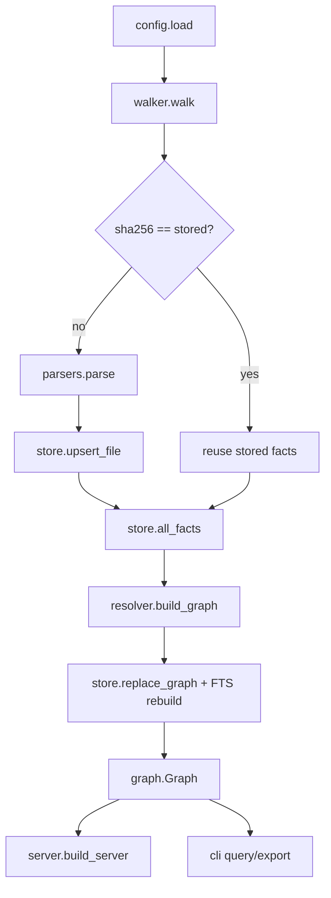

# Architecture

```
repo_graph_mcp/
  config.py      [tool.repo-graph] / .repo-graph.toml / env -> Config (unknown keys are errors)
  paths.py       confinement: safe_join, is_within, read_bounded (O_NOFOLLOW + size cap)
  walker.py      deterministic file list: .gitignore (pathspec), excludes, limits, symlink policy
  facts.py       the per-file facts format (TypedDicts) + small helpers; FACTS_VERSION
  parsers/
    python.py    ast -> facts (defs, imports, uses, type hints)
    typescript.py tree-sitter -> facts for .ts/.tsx/.js/.jsx (optional extra)
  resolver.py    all facts -> Graph(nodes, edges): module naming, imports, types, tests
  store.py       SQLite schema, upserts, graph swap, FTS5 rebuild
  indexer.py     walk -> hash -> parse changed -> resolve all -> store
  graph.py       read-only queries (the logic of every tool) + compact JSON
  server.py      MCP server (mcp 2.x MCPServer, stdio), one tool per Graph method
  export.py      mermaid / dot / json
  clients.py     config snippets for Claude Code, Cursor, Codex, OpenCode
  cli.py         repo-graph index | query | serve | stats | export | config
```

## Data flow



## Two phases: facts, then resolution

Parsing is per file and cached; resolution is global and always re-run.

* **Facts** (`facts.py`) are what a single file says, with no knowledge of
  other files: definitions (`local` path such as `Order.total`, kind, lines,
  signature, first doc line, return annotation), imports (module or
  specifier, level, `[imported, bound]` names, alias), uses (`call`, `base`,
  `ref` with the enclosing scope and the static text: `self.repo.store`,
  `Factory().build`, `super.render`), and type hints (`(scope, name) -> type
  text`, where a trailing `()` means "result of calling").
* **Resolution** (`resolver.py`) needs every file: a renamed function in one
  file changes edges in others, so re-running it is the only correct choice,
  and it is cheap (no I/O, no parsing). Resolution of a use `a.b().c` in
  scope `S`:
  1. head: `self`/`cls`/`this` → enclosing class; `super` → base classes;
     else lexical scopes (nested defs), then type hints in `S` and its
     parents, then module bindings (definitions, imports — following
     re-exports and star imports up to 6 hops);
  2. each further part: a submodule, a module member, a class member
     (methods, then typed attributes, then base classes);
  3. a `()` step turns a class into its instance (same node) and a function
     into its annotated return type.
  If that fails for a call on an unknown receiver, a unique, non-generic
  method name is accepted with `confidence = "name"`.

Module ids: Python uses dotted names, climbing while the parent directory has
an `__init__.py` (so `src/pkg/x.py` is `pkg.x`); every suffix of the path is
also registered as an alias for imports. TS/JS modules are paths without the
extension (`src/util`); `index` files also answer for their directory.
Collisions fall back to the full path.

## Storage

`files(path, sha256, language, size, facts JSON, error)` is the cache;
`nodes` and `edges` are replaced in one transaction per index run; ids are
assigned in a stable order (file, line, qualname), so two runs on the same
tree produce identical databases. `nodes_fts` is an external-content FTS5
table over `name`, `words` (snake/camel split), `qualname`, `doc`.

## Server

`GraphServer` holds one read-only connection guarded by a lock (the SDK runs
sync tools in worker threads). Each tool returns compact JSON text (no `null`
fields, no whitespace); errors raise `ToolError` with a JSON body
(`{"error": ..., "candidates": [...]}`), so the client sees `isError`.
`reindex` closes the connection, runs the indexer and reopens.

## Extending

* A new language: a parser that produces the same facts, an extension map
  entry in `walker.py`, a module-naming rule in `resolver.py`.
* A new question: a `Graph` method, a tool in `server.py`, a `QUERIES` entry
  in `cli.py`, tests, and a README row.
