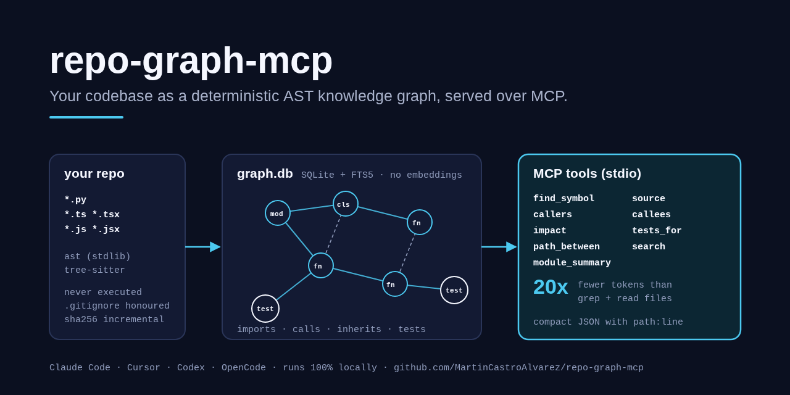
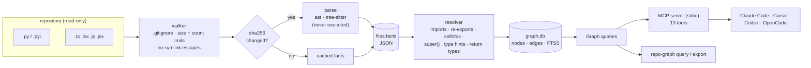
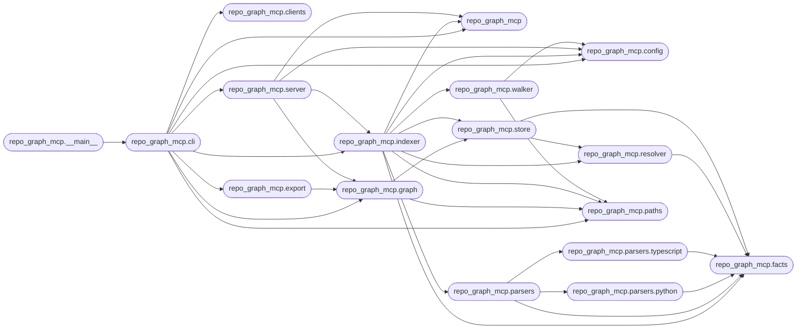

# repo-graph-mcp

> Turn a codebase into a deterministic AST knowledge graph (no embeddings, no vector store, no LLM) and serve it over MCP, so coding agents ask the graph instead of grepping.

[](https://github.com/MartinCastroAlvarez/repo-graph-mcp/actions/workflows/ci.yml)
[](LICENSE)
[](pyproject.toml)
[](pyproject.toml)
[](https://modelcontextprotocol.io)



`repo-graph-mcp` parses Python (stdlib `ast`) and TypeScript/JavaScript
(tree-sitter) into a graph of modules, classes, functions, methods, symbols and
tests, linked by **imports, defines, calls, inherits, tests and references**
edges. The graph lives in one SQLite file (`.repo-graph/graph.db`), is rebuilt
incrementally by content hash, and is served to Claude Code, Cursor, Codex or
OpenCode through the official MCP Python SDK. Every answer is compact JSON with
`path:line`, so the agent jumps to the right lines instead of reading whole
files. Runs 100% locally, no paid APIs required.

## Why

An agent that needs "who calls `parse_order`?" or "what breaks if I change
`Store.open`?" usually greps, opens every file the grep mentions, and reads
them in full. That costs tokens, and grep cannot tell a call from a comment, a
method from a same-named function, or follow `self.repo.store(...)` to
`Repo.store`. A static graph can, and it answers in a few hundred tokens.

| Question on this repository | Graph tokens | grep + read tokens | Savings |
| --- | ---: | ---: | ---: |
| `callers read_bounded` | 213 | 12,190 | 57.2x |
| `impact Store.open` | 1,269 | 35,431 | 27.9x |
| `path_between cli.main->build_graph` | 308 | 19,794 | 64.3x |
| `source Graph.tests_for` | 559 | 6,480 | 11.6x |
| `dependents repo_graph_mcp.paths` | 234 | 154 | 0.7x |
| **All 10 benchmark questions** | **5,808** | **117,818** | **20.3x** |

Measured offline by [`benchmarks/token_savings.py`](benchmarks/token_savings.py)
(full table there; CI re-runs it and fails below 5x). It is not always a win:
for "who imports this module", a grep for `import ...paths` is already small.

No embeddings means no model download, no drift between runs and nothing to
re-embed: the same commit always gives the same graph.

## Quickstart

```bash
pip install "repo-graph-mcp[typescript] @ git+https://github.com/MartinCastroAlvarez/repo-graph-mcp"
cd your-repo && repo-graph index        # -> .repo-graph/graph.db
repo-graph query callers parse_order    # ask from the shell
claude mcp add --scope project repo-graph -- repo-graph serve
repo-graph config cursor                # or codex / opencode
```

It will be `pip install "repo-graph-mcp[typescript]"` once the first release is
on PyPI. Leave out `[typescript]` for a Python-only install (no compiled
dependencies beyond the MCP SDK).

```text
$ repo-graph query callees shop.service:Checkout.run
{"symbol":{"id":"shop.service:Checkout.run","kind":"method","loc":"shop/service.py:22","sig":"(self, items: list[int]) -> Order"},
 "callees":[{"id":"shop.models:Order","kind":"class","loc":"shop/models.py:13","at":23},
            {"id":"shop.models:Order.save","kind":"method","loc":"shop/models.py:28","at":24},
            {"id":"shop.models:audit","kind":"function","loc":"shop/models.py:33","at":25},
            {"id":"shop.service:Repo.store","kind":"method","loc":"shop/service.py:12","at":26}]}
```

`order.save()` resolved through `order = Order(items)`, and
`self.repo.store()` through the `repo: Repo` constructor parameter.

## How it works



1. **Walk.** Source files under the root, sorted, honouring `.gitignore`
   (nested ones too), `exclude` globs, `max_file_bytes` and `max_files`.
   Symlinks are never followed; one that points outside the root is refused.
2. **Parse what changed.** Each file is hashed; only new or changed files are
   parsed. A parser turns a file into *facts* (definitions with signatures and
   first docstring lines, imports, uses with their enclosing scope, and simple
   type hints) stored as JSON next to the hash.
3. **Resolve.** Facts from every file are resolved into one graph: module
   names (src layouts, packages, relative imports), re-exports through
   `__init__.py` / `index.ts`, star imports, `self`/`cls`/`this`, `super()`,
   annotated parameters, `x = Foo()`, `self.x = ...`, return annotations
   (`make().run()`), and the class hierarchy. When none of that works for
   `obj.method()`, a *name* match is used only if exactly one method in the
   project has that name (and it is not a generic one like `get`); those edges
   carry `"conf": "name"`.
4. **Tests.** Test functions/`it()` blocks are linked to what they call; a
   test with no resolvable call falls back to its name (`test_add_numbers_x` →
   `add_numbers`), and a test module to the module it is named after.
5. **Store and answer.** Nodes and edges go to SQLite (parameterised
   statements only) with an FTS5 index over names and docstrings. Queries are
   breadth-first walks with depth and size limits.

The id of a node is `module:Local.path` (`shop.models:Order.total`,
`src/util:Cache.put`); every tool also accepts a dotted name, a bare name, or
`path:line`. Ambiguous names return the candidates instead of guessing.

## MCP tools

| Tool | Answers |
| --- | --- |
| `find_symbol(name, kind?)` | where something is defined (with signature and doc line) |
| `source(symbol, context?)` | only that definition's lines, flagged `stale` if the file changed |
| `callers(symbol, depth?)` / `callees(symbol, depth?)` | the call graph, with the line of each call |
| `dependencies(module)` / `dependents(module, depth?)` | internal imports, external packages, importers |
| `impact(symbol, depth?)` | blast radius: transitive callers, references, subclasses, importers, the tests to run and the files touched |
| `tests_for(symbol)` | tests linked directly, and tests that reach it through calls (with the path) |
| `path_between(source, target)` | the shortest chain of calls/imports/references/inherits |
| `module_summary(module)` | outline of a file: classes with methods, functions, symbols, imports, dependents, tests |
| `search(query, kind?)` | FTS5 over names, `snake_case`/`CamelCase` words and docstrings |
| `stats()` | counts, parse errors |
| `reindex()` | incremental refresh after edits (the only tool that writes, and only to `graph.db`) |

All tools except `reindex` are annotated read-only. `repo-graph query <tool>`
runs the same code from the shell.

## Clients

`repo-graph config <client>` prints these; `--root` pins the repository when
the client does not start the server in it.

| Client | Configuration |
| --- | --- |
| Claude Code | `claude mcp add --scope project repo-graph -- repo-graph serve` (writes `.mcp.json`) |
| Cursor | `.cursor/mcp.json`: `{"mcpServers": {"repo-graph": {"command": "repo-graph", "args": ["serve"]}}}` |
| Codex | `codex mcp add repo-graph -- repo-graph serve`, or `[mcp_servers.repo-graph]` in `~/.codex/config.toml` |
| OpenCode | `opencode.json`: `{"mcp": {"repo-graph": {"type": "local", "command": ["repo-graph", "serve"]}}}` |

`serve` refreshes the index before it starts (`--no-index` skips that). See
[`examples/`](examples/) for ready-to-copy files.

## CLI

```text
repo-graph index   [--root .] [--db PATH] [--full] [--json]
repo-graph query   [--root .] [--pretty] <tool> <args>     # find_symbol, callers, impact, ...
repo-graph serve   [--root .] [--no-index]                 # MCP over stdio
repo-graph stats   [--root .]
repo-graph export  [--root .] --format mermaid|json|dot [--level module|symbol|all] [--focus PREFIX] [-o FILE]
repo-graph config  claude|cursor|codex|opencode [--root PATH] [--exe repo-graph]
```

Exit codes: `0` ok, `1` the question had no answer (unknown or ambiguous
symbol; JSON on stderr), `2` usage or configuration error.

`repo-graph export --focus repo_graph_mcp/` on this repository (Mermaid is the default format):



## Configuration

`[tool.repo-graph]` in `pyproject.toml`, or a `.repo-graph.toml` at the root.
Unknown keys are errors.

| Key | Default | Env override | Meaning |
| --- | --- | --- | --- |
| `exclude` | `[]` | | gitignore-style globs to skip (on top of `.gitignore`) |
| `languages` | `["python", "typescript"]` | | `typescript` also covers `.tsx`, `.js`, `.jsx`, `.mjs`, `.cjs` |
| `max_file_bytes` | `1000000` | `REPO_GRAPH_MAX_FILE_BYTES` | larger files are skipped |
| `max_files` | `20000` | `REPO_GRAPH_MAX_FILES` | the walk stops here (reported) |
| `docs` | `true` | | store first docstring / JSDoc lines (set `false` to keep comments out of answers) |
| `respect_gitignore` | `true` | | honour `.gitignore` files |
| `db` | `.repo-graph/graph.db` | `REPO_GRAPH_DB` | graph location (`--db` wins) |

Always skipped: `.git`, `.venv`, `venv`, `node_modules`, `__pycache__`, tool
caches and `.repo-graph` itself. `*.d.ts` files are ignored. The database
directory gets its own `.gitignore` (`*`), so it never ends up in a commit.

## Limits (by design)

Static and best-effort: dynamic dispatch, `getattr`, decorators that replace
functions, monkey-patching, dependency injection containers and untyped
callbacks are not followed. TypeScript `paths` aliases from `tsconfig.json`
are treated as external packages. When a link is a guess it says so
(`conf: name`); when a name is ambiguous the tool returns candidates.

## Testing

```bash
python -m venv .venv && . .venv/bin/activate && pip install poetry && poetry install --all-extras
poetry run pytest                                  # 87 tests, coverage ~93%
poetry run ruff check repo_graph_mcp tests benchmarks && poetry run mypy repo_graph_mcp
poetry run python benchmarks/token_savings.py      # the table above
```

The tests index two fixture projects (Python, and TypeScript/TSX/JS), check
every resolution rule, drive the MCP server in-process and over a real stdio
subprocess, and enforce the security contract: a fixture module that would
write a file if executed must never run, symlinks out of the root are refused,
the query connection is read-only, SQL is never built from strings, hostile
FTS5 input is inert. A CI job also runs without the `typescript` extra.

## Part of the series

| Series | Repositories |
| --- | --- |
| Agent tooling | [agent-lint](https://github.com/MartinCastroAlvarez/agent-lint) · **repo-graph-mcp** · [s3-agent-memory](https://github.com/MartinCastroAlvarez/s3-agent-memory) · [pytest-llm-evals](https://github.com/MartinCastroAlvarez/pytest-llm-evals) · [serverless-mcp-aws](https://github.com/MartinCastroAlvarez/serverless-mcp-aws) · [agent-model-router](https://github.com/MartinCastroAlvarez/agent-model-router) |
| Django admin family | [django-admin-react](https://github.com/MartinCastroAlvarez/django-admin-react) · [django-admin-rest-api](https://github.com/MartinCastroAlvarez/django-admin-rest-api) · [django-admin-mcp-api](https://github.com/MartinCastroAlvarez/django-admin-mcp-api) · [django-admin-graph](https://github.com/MartinCastroAlvarez/django-admin-graph) · [django-admin-skills](https://github.com/MartinCastroAlvarez/django-admin-skills) |
| Apps | [local-rag-ollama](https://github.com/MartinCastroAlvarez/local-rag-ollama) · [ui-review-agent](https://github.com/MartinCastroAlvarez/ui-review-agent) |
| Patterns catalog | [agentic-architectures](https://github.com/MartinCastroAlvarez/agentic-architectures) — every agent pattern, linking the LangGraph, ADK, CrewAI and LangChain repos |

## Contributing

See [`CONTRIBUTING.md`](CONTRIBUTING.md), [`ARCHITECTURE.md`](ARCHITECTURE.md),
[`SECURITY.md`](SECURITY.md) and the agent contract in [`CLAUDE.md`](CLAUDE.md).

## License

MIT © 2026 Martín Castro Álvarez. See [LICENSE](LICENSE).
